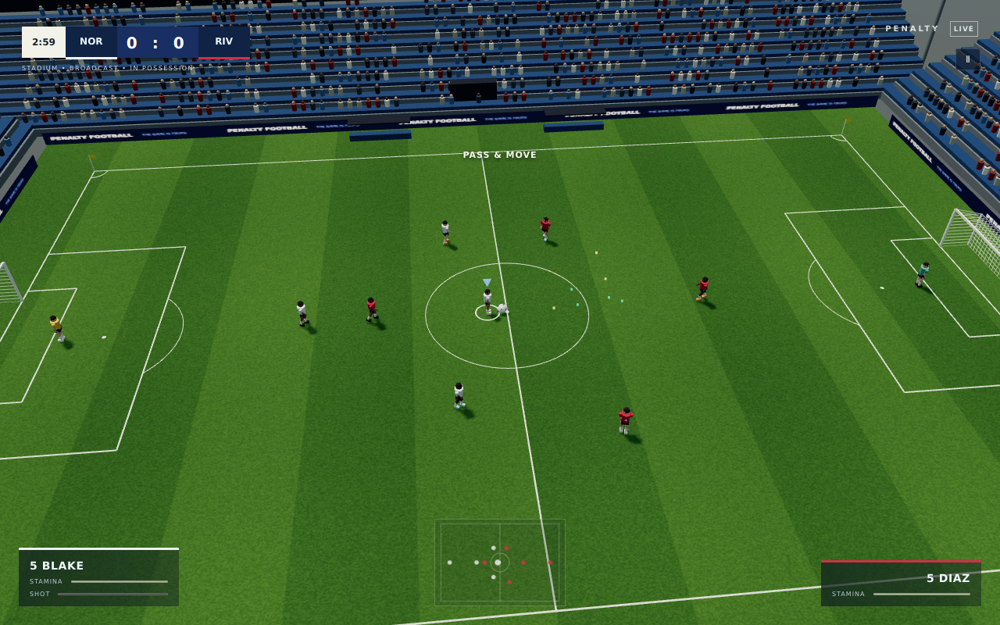

# Penalty • Five-a-side

A static, procedural 3D arcade soccer game: 4 outfield players and a goalkeeper per team. No build, backend, accounts, asset downloads, or runtime CDN dependency. Three.js 0.170.0 is vendored in `libs/`, with its MIT license.

## World / 02 overhaul

- **Save Health:** every write is validated and read back. Invalid numeric counters are repaired within safe limits (maximum 100 million); the damaged original is retained for recovery export. A previous verified save is kept locally. Structural damage falls back to that backup when available, otherwise progression stays protected until a valid import. The Save Health tab offers Check, Repair, Restore Previous, and export/import. Repair cannot reconstruct lost cards or careers. Storage failures are reported; export before closing a session that cannot save.
- **Animation:** a new procedural controller blends distance-driven jogging/sprinting, closer dribbling steps, turning lean, bent elbows/knees, kick backswing/follow-through, slide recovery, headers, goalkeeper dives and celebrations. Players have independent gait phases. These remain stylized rigid-part animations, not motion capture.
- **Stadium Studio:** Grand Arena, Metro After Dark (skyline), Coastal Park (sea and palms), and Community Ground (clubhouse and trees). Choose classic, emerald, mint, ocean blue, violet, terracotta or ivory turf. Settings persist and apply to every mode; finish/abandon a pending match before changing them.
- **Top Corner integration:** the country/name pools and fictional club naming conventions from [xerox-gh/Top-Corner](https://github.com/xerox-gh/Top-Corner) are adapted in `js/world-data.js` and `js/world.js`. The redesigned hub leads to 38 countries, 76 divisions and 1,256 clubs, exhibitions and a separate offline World League career. Play or simulate 30/38 home-and-away fixtures, view standings/results, then advance a season with three-club promotion/relegation between paired divisions. Your club identity persists across promotion. This ports leagues and menu ideas into Penalty's 5v5 engine; it does not merge Top Corner's 11v11 engine, editor or transfers. World clubs use their own generated five-player rosters; existing collectible-squad and player careers remain separate.
- **Five card stats:** PAC, SHO, PAS, **STR**, **DRI** appear on cards and in the player creator/training system. STR influences shielding and contact displacement; DRI affects close touches and first-touch reach. Existing collectible OVRs stay fixed. Older custom players receive STR/DRI defaults based on their previous stats, preserving their overall rating and career progress.
- **51 nationalities:** expanded country choices include USA, Croatia, Brazil, Spain, Portugal, Mexico, Canada and more. Flags are generated as offline SVGs; some emblems are simplified. Existing assigned identities remain stable.

Save safety constants are in `js/save-health.js`; attribute derivation in `js/card-stats.js`; venue/turf palettes in `js/venues.js`; gait/action timing in `js/animation.js`; world fixtures and season movement in `js/world.js`. World Career currently keeps one selected club per save and the current season's results. Keep an exported backup if you want to experiment with another save.

Validation for this update: all nine Node test suites pass, including full promotion/relegation seasons, legacy stat migration, bad counters, structural corruption, backup recovery and write protection. Headless Chromium checks passed under `/Penalty/` for a playable ten-player world fixture, result settlement/simulation, all four venue selections, turf persistence, Save Health repair, a 390px mobile layout, and offline reload with no console errors. Real-device performance and Safari/Firefox/Edge testing remain outstanding.

## Play locally

From the repository root:

```sh
python3 -m http.server 8000
```

Open http://localhost:8000. Use HTTP rather than opening the HTML file directly: ES modules and the offline service worker need a server. Audio starts when you press Play match. Service workers work on localhost or HTTPS; wait for the first cache installation before going offline.

## GitHub Pages

Entry point: **`index.html` at the repository root**.

1. Push these files to `main`.
2. Settings → Pages → Deploy from branch → `main` / **root** → Save.
3. Open `https://xerox-gh.github.io/Penalty/` once deployment finishes.

All asset URLs are relative. The vendored engine and game modules are precached in the repository's service-worker scope. Bump `CACHE` in `sw.js` when publishing updates.



## Reference-inspired stadium update

The new look blends a readable retro football presentation with a wider broadcast camera and modern stadium details: procedurally textured grass, four-sided terraces, individual instanced spectators, slim articulated low-poly players, compact scoreboard and paired player-name panels. All visuals are generated by the game.

- **Stadium** is the default, with open touchlines and kick-ins, corners and goal kicks. **Arena** retains the rebound boards.
- Choose Broadcast, Tactical, Classic or Player camera in setup; C cycles them during play.
- Hold **Z** for close control. Hold Z while releasing Space for a placed, curling shot.
- **Shift + E** passes and sends the original passer on a forward run, with control switching to the receiver.
- Gamepad **LT** is precision, **RT** is through ball, and **RB + B** is pass-and-run. Local P2 uses apostrophe for precision.
- Touch adds CONTROL and THROUGH buttons. Hold CONTROL with SHOOT for a placed shot, or RUN with PASS for a forward run.

Tune `CFG.control` for touch distances, dribble spring, precision speed, finesse power/spin, tackle reach and run duration. This remains an original 5v5 arcade game with simplified set pieces, not an exact recreation of the games in the references.

## Offline club update

The title screen now opens your club hub:

- **Career:** a six-club, ten-match season, league table and results. Finish in the top two to progress from Division 3 to Division 1. Difficulty rises with division. Season champions collect a trophy.
- **Knockout cup:** quarter-final, semi-final and final, with golden goal and a trophy for three wins.
- **Challenges:** come back from 0–2, win without conceding, or score three in 90 seconds. First completions award badges and bonus packs.
- **Squad & cards:** 112 guide players across eleven rarities, plus retained legacy cards. Equip owned cards in five position-specific slots. Card attributes grant modest pace, shot-power and pass-speed bonuses (roughly 0–7%). Earned reward packs contain three cards, guarantee one new card while the album is incomplete, and quick-sell duplicates at their tier value.
- **Quests:** twelve one-time milestones and three repeating contracts. Claim all contracts to refresh the board. Match rewards, quests and level-ups earn coins, XP and packs; every 300 XP grants a pack.
- **My club:** unlock five kit colors with earned coins, view trophies and records, and export/import your save.

Players now have varied hair styles/colors, faces, ears, collars, cuffs, crests, detailed boots, keeper gloves and named/numbered shirts. Geometry and most materials remain shared.

Everything runs locally, including fixtures, card draws and rewards. No real-money purchases, accounts, server, calendar timers or network checks. Your browser stores progress in `localStorage`. **Export a backup before clearing browser data or moving to another device/address.** Import replaces the current club; malformed saves are rejected. If browser storage fails, the hub says progress is session-only and still allows export. Unreadable existing saves are preserved for recovery rather than overwritten.

Leaving a match or reloading keeps the pending fixture. Resume restarts it from kickoff; abandon earns nothing. Results and quest rewards are applied only once. This is a compact club career, without transfers, player aging or a full management simulation; a separate Player Career is available. Quick Match still provides custom settings and local two-player play.

Tune the catalog, rewards, challenges and fixtures in `js/progression.js`; `js/club.js` contains the hub. Card attribute multipliers are in `js/player.js`. The save schema is versioned; changing it requires a migration or a new save key.

## Coin pack shop: spreadsheet guide

The shop follows the supplied `pack_shop_draft.xlsx` (Packs, Drop Rates, Tiers and Players). The 112 listed players have the exact supplied names, positions, ratings and rarities. `js/shop-guide.js` contains the transcribed data; no spreadsheet engine or download is needed at runtime.

| Pack | Coins | Cards |Rookie|Club|Rare|Elite|Champion|Legend|Heroes|Icon|Mythic|Glory|Eternal|
|---|---:|---:|---:|---:|---:|---:|---:|---:|---:|---:|---:|---:|---:|
|Bronze Pack|500|3|45%|35%|15%|4.5%|0.5%|0%|0%|0%|0%|0%|0%|
|Silver Pack|1,500|4|15%|35%|30%|15%|4%|1%|0%|0%|0%|0%|0%|
|Gold Pack|4,000|5|0%|15%|35%|30%|14%|5%|0.9%|0.1%|0%|0%|0%|
|Premium Pack|10,000|5|0%|0%|20%|35%|25%|14%|4%|1.5%|0.5%|0%|0%|
|Ultimate Pack|25,000|5|0%|0%|0%|22%|32%|25%|13%|6%|1.5%|0.4%|0.1%|
|Glory Pack|75,000|3|0%|0%|0%|0%|10%|25%|25%|20%|12%|6%|2%|

Every slot rolls independently, then uniformly selects a player in the chosen tier. Displayed odds include duplicates and are per card, not per pack. Purchases open immediately and save the deduction, cards and duplicate refunds in one transaction. No real money or network connection is involved.

| Tier | Players | OVR | Quick-sell coins |
|---|---:|---|---:|
|Rookie|6|55–64|25|
|Club|10|65–69|75|
|Rare|10|70–74|200|
|Elite|10|75–81|600|
|Champion|16|82–85|1,500|
|Legend|10|86–89|3,500|
|Heroes|10|84–89|7,000|
|Icon|10|90–97|15,000|
|Mythic|14|95–97|30,000|
|Glory|8|94–99|60,000|
|Eternal|8|99–100|150,000|

Duplicates automatically quick-sell at the listed tier value. An owned player outside your starting five can also be quick-sold from their card. Starting players must be replaced before selling; selling is disabled while a match is pending.

Previously collected players remain usable. The original 24 cards are marked Legacy and do not dilute the spreadsheet's draw pools; unowned legacy cards are hidden. The 28 previously added special players retain their IDs. Existing coins, squads, saves, earned packs and claimed milestones remain compatible. The collection counter and new 112-player milestone count guide players only.

Earned reward packs remain three-card packs with one guaranteed unowned guide player while the guide album is incomplete. They are separate from shop odds. The spreadsheet's 150 coins per match is a planning assumption, so actual match/quest earnings remain unchanged.

`tests/shop.mjs` checks every odds interval, guide prices/card counts, all six expected quick-sell returns, duplicate refunds, insufficient funds, selling restrictions, save compatibility and equipping special cards. Desktop/mobile-emulated browser checks cover reveals, offline purchases, persistence and quick-selling. Real-device checks remain outstanding.

## Matching player appearances

Each card and its in-game player share a deterministic appearance based on the stable player ID: buzz cut, textured crop, side part, quiff, curls, afro, locs, braids, bun or bald. Profiles also vary skin and hair colors, eye colors, face proportions, eyebrows, noses, mouths, beards, moustaches and goatees. Hair now has swept layered locks, tapered temples, rounded locs, scalp-following braided rows, and textured curls/afros with subtle highlights. Strand geometry is baked and cached as one mesh per head to keep match draw calls low. Card tooltips show the hairstyle name. Keepers wear the same gold kit in their home card portrait and on the pitch.

`js/appearance.js` owns the shared profiles and hair shapes, plus the procedural SVG portraits. `js/player-head.js` builds low-poly 3D heads using shared geometries/materials. No image downloads or save migration are required. These are stylized matching features, not photorealistic portraits or a player appearance editor.

Run `node tests/appearance.mjs` for identity stability, coverage of all ten hairstyles and shared card/model profiles. Headless Chromium also rendered all ten 3D heads beside their SVG portraits, checked equipped-player identities, started a match and reloaded offline without page errors.

## Pack openings and nationalities

Shop and earned packs now open in a full-screen reveal: open the sealed pack, see each player's country and position, then reveal the card with its rarity color and procedural sound. Heroes and higher add confetti. Next Player advances one card at a time, View All shows the full pack, and Skip to Results bypasses the sequence. Escape closes the reveal. Reduced-motion preferences disable animations and suspense delays.

Purchases and earned-pack rewards are committed **before** the reveal appears. Skipping, closing, hiding the tab or reloading cannot re-roll or grant the pack again. If browser storage is unavailable, the existing session-only warning remains visible. Background shop actions are blocked while the dialog is open. The ending summary returns to the club without changing the saved rewards.

All 112 guide players and retained legacy players have stable fictional nationalities, shown with procedural SVG flags and country names on cards. The active player's match tag also includes the country code. These are creative biographies, independent of appearance, ratings and pack odds. Edit the explicit special-player assignments or country catalog in `js/nationality.js`; no flag assets or network requests are needed.

`js/pack-opening.js` owns presentation only; progression remains in `js/progression.js`. `node tests/nationality.mjs` checks complete coverage, stable identities and self-contained flags. Desktop and mobile-emulated Chromium checks passed for five-card sequential reveals, country flags, skip, Escape, duplicate-purchase blocking, no duplicate rewards, mid-opening reload persistence, offline purchases and reduced-motion behavior.

## Collectible card presentation

Cards use reference-inspired shield silhouettes, metallic bronze/silver/gold base finishes, and foil special-tier frames. Ratings and positions sit in the upper corner, the player portrait fills the center, and the lower panel holds the full name, five PAC/SHO/PAS/STR/DRI attributes, country flag/code and an original club crest. Icon portraits use a monochrome treatment. Every rarity has its own palette. Collection ownership and quick-sell controls sit below the shield.

The same card renderer is used in the collection, individual pack reveals and pack summaries. Two-column mobile layouts keep names and flags legible. This is a CSS/SVG presentation change: card ratings, rewards, pack odds, identities and save data are unchanged.

## Controls

| Action | Player 1 | Local player 2 | Gamepad |
|---|---|---|---|
| Move | WASD; arrows in solo mode | Arrows | Left stick |
| Sprint | Left Shift | Right Shift | RB |
| Shoot | Hold Space, release | Hold Enter, release | Hold A, release |
| Pass | E | / | B |
| Through ball | R | ; | RT |
| Chip | Q | . | X |
| Slide | F | , | Y |
| Switch | Tab | Backspace | LB |
| Close control / placed shot modifier | Z | Apostrophe | LT |
| Pass and run | Shift + E | Right Shift + / | RB + B |
| Camera | C | Shared | — |
| Pause | P / Esc | Shared | — |
| Mute | M | Shared | — |

Touch devices display a joystick and eight action buttons. Use movement direction to aim passes and choose the finish; close-range shots are assisted. Neutral-stick switching selects a player near the ball; switching with movement favors that direction. Auto-switch can be disabled in setup. The home team attacks the right-hand (+X) goal for the whole match.

## Included

- 2 / 3 / 5-minute matches, optional golden goal, local keyboard versus mode, three difficulties, team names/colors and three formations.
- Fixed 60 Hz ball simulation: gravity, bounce, drag, rolling friction, sidespin, player/post/crossbar/board collisions. Lofted balls can leave the pitch and trigger kick-ins, corners or goal kicks.
- Role anchors shift with play, at most two AI outfield chasers per team, marking, scored passing lanes, shooting and goalkeeper prediction/catch/parry/distribution.
- Lineup, countdown, kickoff, goal camera/celebration, pause, full-time and replay match flow.
- Four cameras, procedural players/net/striped grass/crowd/floodlights, instanced crowd, shadows, particles, radar, stamina, shot meter, synth audio and volume/mute.
- Low/Medium/High quality and automatic downgrade after sustained rendering below 40 FPS. Hidden tabs pause matches.

## Tuning / scope

`js/config.js` holds pitch dimensions, player speeds/stamina, ball constants, formation anchors, difficulty and timing. Goalkeepers and field-player heuristics live in their respective modules. This is an arcade implementation: slide-contact fouls are implemented, but cards, offside, substitutions and halftime are not. Restarts use a short setup phase followed by interactive aiming; see the set-piece guide below. The goal camera is a live celebration swing, not a recorded replay. Audio is synthesized; crowd ambience is filtered noise. No multiplayer networking.

Low-poly procedural animations cover running, kicking, sliding, diving and celebration; these are simple rigid-part poses, not skeletal motion capture. The offline career keeps the current season’s results and club statistics. Quality performance varies by GPU; use Low on older hardware.

## Progression validation

Desktop and mobile-emulated Chromium checks passed for the hub, pack reveal, career start/finish, reward claims, backup download/import, offline reload/play and pending-fixture resume, with no console errors or missing assets under `/Penalty/`.

Run `node tests/progression.mjs` with a current Node.js version. Tests cover all 30 directed league pairings, a complete season and promotion, cup wins/elimination/restarts, all challenges, single-claim rewards, card completion, position rules, kits, save reload, malformed imports, corrupt-save recovery and storage failure. The game itself requires no Node.js or build step.

## Validation performed

`node tests/smoke.mjs` checks both goals, kick-ins, corners, goal kicks, board bounce, gravity, shots, keeper catch/distribution, formations, golden goal/full-time and a 180-second simulation with all ten players. JavaScript syntax and HTTP asset paths under `/Penalty/` were also checked. Headless Chromium rendered the game without console errors, accepted movement/shot/pass/camera input, exercised pause/resume, goal/golden-goal/full-time, and reloaded successfully offline after service-worker installation. The richer stadium and articulated players add detail; previous draw-call and triangle counts no longer describe the current scene. The latest update also checks placed shots, pass-and-run, both pitch-rule modes, and mobile portrait touch targets in Chromium emulation. Real-device Chrome/Firefox/Safari/Edge and physical gamepad validation remain outstanding. The headless browser uses software rendering, so neither simulation timing nor these checks establish 60 FPS on real hardware.

### Player Career

Open **Player Career** in the club hub (separate from Club Career). Create an outfield player with a name, DEF/MID/FWD position, nationality, hair/face choices, pace, shooting, passing, strength and dribble from 1–100, and any card rarity from Rookie to Eternal. The card preview updates as you edit. Overall is the rounded average of the five stats; rarity controls the card artwork independently. Save the player before starting a fixture. Existing collectible players, squad and club-career standings are unaffected.

Player-career fixtures last two minutes and lock control to your player, including after passes, goals and restarts. Tab/manual switching and automatic switching are disabled in this mode; teammates and the goalkeeper use AI. The custom player's five attributes affect pace, shots, passing, shielding and ball control. Goalkeeper careers, transfers and individual goal/assist attribution are not included; the dashboard labels wins and fixture scores as team results.

Each season has ten fixtures. Earn three points for a win and one for a draw; reaching 18 points earns a title, 400 bonus coins and two packs. Wins award three training points, draws/losses one. Spend a training point for +1 to a chosen stat (maximum 100). You can also edit your creation between matches without resetting career progress. Start the next season after all ten fixtures; appearances, wins, XP, titles and unspent training points carry over. Career progress and the custom player are included in the normal offline save and backup export/import. Older saves migrate with no player career until one is created.

`node tests/player-career.mjs` covers creation, appearance, validation, old-save migration, pending-match recovery, training, ten-fixture season rewards, duplicate settlement, backups and isolation from club career. Browser checks cover live preview, a playable custom midfielder with locked controls, match rewards/training, a 390px mobile layout and offline reload without console errors.

### Fouls and set pieces

Sliding into an opponent near the ball without reaching the ball first now awards a direct free kick, or a penalty inside the defending team's painted box. Clean ball-first tackles and ordinary body contact remain legal. Penalties use the existing six-metre spot, with the goalkeeper on the goal line and other outfield players outside the area/arc. Free kicks in the attacking half get a two-player wall at a five-metre small-sided distance. These are arcade, small-sided rules: no cards, offside, handball, advantage or penalty shootout mode.

All restarts now pause for positioning, then show an aiming panel and a dedicated camera. Corners place attackers at the near post, central area and far post with defenders goal-side. On delivery they make short attacking runs and tracking runs. High balls can be headed towards goal or cleared automatically on contact, and walls block body-height shots. Goal kicks start inside the goal area, while kick-ins use the touchline (inside the boards in Arena). The match clock pauses during setup/aiming. A penalty awarded before full-time is allowed to finish its flight, save or miss.

| Action | Mouse / touch | Keyboard P1 / P2 | Gamepad P1 |
|---|---|---|---|
| Aim | Tap target, or drag from the white ball | WASD / arrows (P1 may also use arrows in solo) | Left stick |
| Shoot / deliver | Drag from ball toward target and release, or TAKE KICK | Hold/release Space / Enter | Hold/release A |
| Curl | Bend the stroke; or cycle CURL button | R / semicolon | RT |
| Short restart (except penalties) | SHORT PASS | E / slash | B |
| Driven / lofted delivery | Delivery button | Q / period | X |
| Defend a penalty | Choose DIVE LEFT, CENTER or RIGHT before the shot | Left/right movement keys | Left stick |
| Pause | Pause button | P / Esc | — |

Longer gestures add power. The red power zone increases the chance of shooting over; targets beyond the posts or above the crossbar can miss. Curved strokes add spin (reduced on penalties). Corners and goal kicks default to lofted delivery. A cancelled touch does not fire. Human restarts auto-take after 25 seconds; AI restarts take roughly three seconds. Keeper directions are relative to the panel/behind-taker camera. When defending an AI penalty, its chosen target is hidden. Player Career keeps your created player selected after the kick; they take outfield restarts and the AI goalkeeper takes goal kicks.

Tuning lives in `CFG.setPiece` in `js/config.js`; `js/set-pieces.js` owns restart positioning/ballistics and `js/set-piece-ui.js` owns the pointer aiming panel. The service-worker version is bumped and installation bypasses stale HTTP assets. Reload online to receive the update; existing club/career saves are unchanged.

Validation: `node tests/set-pieces.mjs` checks fouls at both ends, box boundaries, legal tackles, wall distance, penalty exclusion, every restart for both teams, AI/career control, shot height, body blocks, camera-relative aim and full-time penalty extension. Headless Chromium checks mouse penalty strokes, keyboard corner charging, short free kicks, pause/resume, touch drag/cancellation at 390px, AI penalty/keeper selection and offline reload from `/Penalty/`. Physical gamepad and real-device Safari/Firefox validation remain outstanding.

## Test checklist

- [ ] Load `/Penalty/` under a repository subpath; all imports and CSS return 200.
- [ ] No browser console errors or missing assets.
- [ ] Ten players stay on pitch, keep formation and contest possession.
- [ ] Move/sprint/pass/charge shot/chip/slide/switch, score into both goals.
- [ ] Check keeper saves/distribution, kick-ins, goal kicks, corners, free kicks and penalties.
- [ ] Pause/resume, hide tab, finish match, golden goal, play again.
- [ ] Test local P2 and a standard-mapping gamepad.
- [ ] Test mobile joystick/buttons in portrait and landscape.
- [ ] First online load installs service worker; reload and play offline.
- [ ] Smoke-test current Chrome, Firefox, Safari and Edge on real devices.

- [ ] Open a pack, equip a card, complete a career fixture and claim a quest.
- [ ] Reload and verify coins, squad and league progress persist.
- [ ] Export/import a backup; malformed imports must preserve the existing club.
- [ ] Resume an unfinished fixture offline and verify it starts at kickoff.


- [ ] Save Health repairs bad counters without losing cards/careers; recovery export retains the original.
- [ ] World fixture results persist; promotion/relegation retains the selected club.
- [ ] All four stadiums, seven turf colors and five card stats render on mobile.
